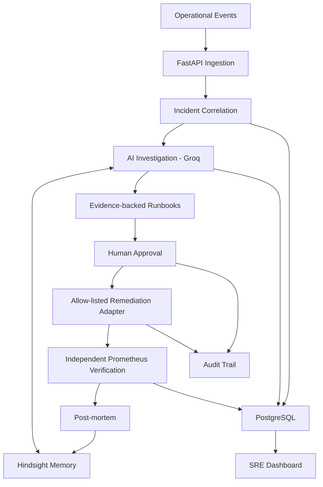

<div align="center">
# OpsMemory
### AI-assisted incident response, controlled remediation, and continuous operational memory

[](https://python.org) [](https://fastapi.tiangolo.com/) [](https://postgresql.org/) [](https://prometheus.io/) [](https://groq.com/)

**Observe → Correlate → Investigate → Approve → Remediate → Verify → Learn**
</div>

## Overview

OpsMemory is an AI-assisted SRE platform that combines operational event ingestion, incident correlation, Groq-powered investigation, Hindsight memory, PostgreSQL persistence, human-approved remediation, and independent Prometheus recovery verification.

Its central design principle: an AI hypothesis is not a verified root cause, and a remediation response is not proof of recovery.

## Architecture



## Core capabilities

| Capability | Description |
|---|---|
| Event ingestion | FastAPI operational event intake |
| Incident correlation | Groups related signals into incident workflows |
| AI investigation | Evidence-grounded Groq investigation hypotheses |
| Persistent memory | Hindsight recall and gated post-mortem retention |
| Runbook guidance | Evidence-backed response recommendations |
| Human approval | Approval gate before protected remediation |
| Remediation | Allow-listed adapter operations |
| Recovery verification | Independent Prometheus metric checks |
| Auditability | Persistent audit and incident records |
| SRE dashboard | Incident workspace and operational visibility |

## Verified demonstration

A controlled `hackathon-test` workflow was executed for incident `4399ed401bce`.

- Service: `payment-gateway`
- Environment: `hackathon-test`
- Remediation adapter: `gateway-restore-test`
- Execution result: `changed: true`
- Simulation flag: `simulated: false`
- Previous state: `degraded`
- Resulting state: `healthy`
- Recovery verification: Prometheus criteria met
- Post-mortem: retained in Hindsight as a verified recovery record

### Evidence boundaries

This demonstrates a real, non-simulated remediation in an isolated hackathon test environment. It does **not** demonstrate production payment-gateway recovery. The incident root cause remains an unverified hypothesis; verified recovery does not prove the proposed cause. Production remediation is not authorized or claimed.

## Memory and learning

Hindsight provides contextual recall and post-incident retention. A controlled memory experiment recorded that recalled memory changed recommendation actions. This is evidence of memory influence in that experiment, not proof of production-wide learning effectiveness.

## Safety and reliability

- Human approval before protected remediation.
- Allow-listed actions instead of unrestricted command execution.
- Independent recovery verification using Prometheus.
- PostgreSQL persistence for incident and audit data.
- Tenant-isolation checks against disposable PostgreSQL test data.
- Clear separation between verified outcomes and unverified hypotheses.
- Controlled test evidence is not represented as production validation.

## Technology stack

| Layer | Technology |
|---|---|
| Backend | Python, FastAPI |
| AI investigation | Groq |
| Operational memory | Hindsight |
| Persistence | PostgreSQL, JSONB |
| Telemetry | Prometheus |
| Dashboard | HTML, CSS, JavaScript |
| Testing | Pytest |
| Deployment | Docker, Docker Compose |

## Repository structure

```text
OpsMemory/
├── backend/
│   ├── app/
│   └── tests/
├── canary/
├── db/
│   ├── migrations/
│   └── rollback/
├── docs/
├── evidence/
├── frontend/
├── gateway/
├── scripts/
├── docker-compose.yml
├── prometheus.yml
└── README.md
```

## Getting started

```bash
git clone https://github.com/Areef509/OpsMemory.git
cd OpsMemory
cp .env.example .env
```

Configure the required credentials and service settings in your local `.env` file. Never commit secrets. Review `REQUIREMENTS.md`, `docker-compose.yml`, and `docs/SUBMISSION_DELIVERABLES.md` before starting services.

## Tests and evidence

- `backend/tests/` — unit and integration tests
- `evidence/` — verification records and supporting artifacts
- `scripts/` — provider and audit verification utilities
- `db/migrations/` — database migrations
- `TRACEABILITY.md` — requirement traceability

Interpret test results according to their recorded environment; a local test is not automatically a production validation.

---

<div align="center">
**Building more explainable, controlled, and verifiable AI-assisted operations.**

[View OpsMemory on GitHub](https://github.com/Areef509/OpsMemory)
</div>
